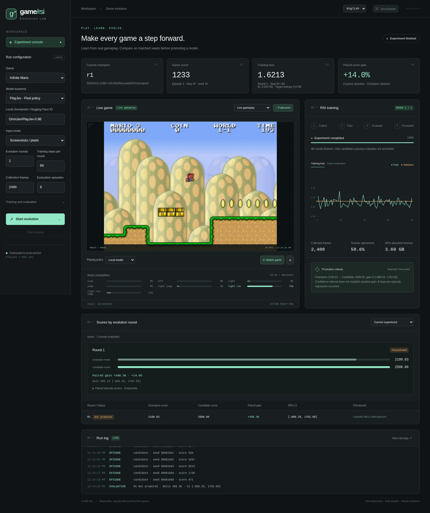

# game-rsi

[English](README.en.md) · [简体中文](README.md)

A model improvement workbench for real HTML5 games: **play → teacher correction → weight updates → paired evaluation → champion promotion**.

It combines [PlayJev](https://github.com/OmniJev/PlayJev) game environments, teachers, and pixel policies with [RSI-Jev](https://github.com/Shanghua-Gao/RSI-Jev) native decision models. A FastAPI dashboard shows live gameplay, action probabilities, training loss / KL, and evaluation results.



## Features

- Ten games: Snake, 2048, Tetris, Pacman, Racer, Invaders, Sokoban, Mario, Floppy Bird, and Breakout.
- Actual Chromium screenshots or structured game states, native weight updates, and checkpoint prediction checks after reload.
- Teacher correction with separate training, validation, and game-evaluation seed namespaces.
- Matched-seed comparisons promote positive average gains by default, with optional strict confidence and regression gates.
- Separate training and gameplay workers, cached-model game switching, historical experiments, and cancellation. Switching games requests cancellation of ongoing training and RSI evolution.
- Chinese and English interfaces with persisted language preference. A table accumulates scores before and after training across all experiments for the selected game, with paired gains, confidence intervals, and expandable episode details. Switching games restores that game’s training history or clears the panel if none exists.
- MJPEG live video and actual intermediate animation frames for Mario and Floppy Bird. The default display target is 30 FPS; observed performance depends on the model and hardware.

Each round and new experiment starts from the most recently promoted weights for the same game, parent model, and input contract. Rejected candidates keep their score records; later training continues from the approved model. After experiment data is cleared, training starts from the selected base model.

Training imitates teacher action distributions. Scores on training seeds select data; scores on independent evaluation seeds determine promotion. The experiment loop adjusts its recipe; this version does not include a research agent that rewrites project code.

## Quick start

Install Git, Python 3.12+, [uv](https://docs.astral.sh/uv/getting-started/installation/), and system libraries needed by Chromium. Model training requires a compatible PyTorch installation. The default device is `cuda:0`; local GPU validation used NVIDIA GB10.

```bash
git clone https://github.com/gaohuan2020/game-rsi.git
cd game-rsi
python3 scripts/bootstrap.py --train --browser
.venv/bin/game-rsi serve --port 8092
```

Open **http://127.0.0.1:8092**. New experiments default to **70 training steps per round**; existing runs retain their recorded steps. Choose a model, game, and recipe, then start evolution. The dashboard also starts live model gameplay. Teacher / Random modes run baseline policies without loading a decision model. Use the language selector in the top bar to switch between Chinese and English.

The bootstrap script verifies the source archives committed in `upstreams/`, restores the versions in `upstreams.lock.json`, and creates a local `.venv`. Source restoration does not contact upstream Git servers and survives rewritten upstream history. Use `python3 scripts/bootstrap.py --sources-only` to restore only the sources. Python dependencies and Chromium still require downloads. First use downloads model weights from Hugging Face; local checkpoint paths are also supported.

Check GPU access before starting a CUDA experiment:

```bash
.venv/bin/python -c 'import torch; print(torch.__version__); print(torch.cuda.is_available()); print(torch.cuda.device_count())'
```

Use the [official PyTorch installation instructions](https://pytorch.org/get-started/locally/) for your hardware. Containers and restricted execution environments must expose GPU devices to the Python process.

An existing environment containing compatible training and service dependencies can be reused read-only:

```bash
python3 scripts/bootstrap.py \
  --reuse-python /path/to/existing-cuda-env/bin/python \
  --browser
```

This uses a `.pth` reference and requires the existing environment to contain compatible `torch`, `torchvision`, `transformers`, and service dependencies. Reinstall the environment when moving to another machine.

## Backends

| Backend | Model | Input | Updated weights |
| --- | --- | --- | --- |
| PlayJev | `OmniJev/PlayJev-0.8B` | Screenshots | Last two language layers by default; optionally the language backbone; vision and token embeddings stay frozen |
| RSI-Jev | `shgao/rsi-jev-v1.0-qwen3.5-0.8b` | Structured state | Native option scorer, optionally the text backbone |
| RSI-Jev single-exit VL | Local or HF single-exit VL checkpoint | Screenshots | Native scorer, optionally the text backbone; vision stays frozen |

RSI's `input_mode=auto` inspects model metadata to select pixels or state. PlayJev uses pixels. Multi-exit RSI models support gameplay, but this training pipeline supports single-exit models.

Structured state and pixels expose different information, so scores across these input modes are not a fair model comparison. Snake state includes grid-derived collision and food-distance features without teacher labels or accumulated scores.

Each round registers its configuration and evaluation seeds, collects teacher-labeled trajectories, trains with AdamW and gradient clipping, saves the checkpoint, checks reload parity, and evaluates the candidate on matched game seeds. By default, 25% of collection episodes are teacher-guided. Set `teacher_mix=0` for model-only trajectories with teacher correction.

The default collection budget is **1000 observations per round**. `data_strategy=trajectory` adapts candidate selection and stratified sampling from [MASS Algorithm 3 and Appendix B.2](https://arxiv.org/pdf/2610.12176) to verifiable game outcomes:

- Collect up to three candidates per seed and keep the best two by score gain within the same round, seed, and horizon. Budget-interrupted and teacher-abandoned candidates cannot become elite demonstrations. Their informative teacher corrections can still be used.
- Filter invalid/uniform teacher labels and identical observation/label pairs within a trajectory. Legacy shards remain usable without invented rankings. Outcomes and provenance never enter model inputs.
- Reserve at least half the bounded replay buffer for the latest round when history exists. Draw fresh/history rounds with equal probability, then corrections/elite samples with 25%/75% probability, followed by uniform behavior-role and episode sampling. Missing categories fall back to available data.
- Each separate `seed % 10 == 0` validation seed gets one rollout, without outcome selection or a candidate tournament. Promotion seeds remain protected. Filtering usually leaves fewer training examples than raw observations.

`collect_steps` is the total budget shared by candidates, not a per-candidate multiplier. Collection also bounds individual episode lengths to cover multiple seeds. `data_strategy=uniform` restores the original replay strategy for controlled comparisons. Per-round `data-selection.json` records rankings, exclusions, splits, and actual draws; `episodes.jsonl` stores original outcomes. This adapts data handling rather than reproducing the full multi-agent workflow. Score improvements require paired evaluation.

The score chart includes all experiments for the selected game in cumulative-round order, including rejected candidates. Selecting a training record changes loss and training details while preserving score history. Different experiments can have different configurations, so the chart describes recorded trends.

The default `promotion_rule=positive_gain` promotes a candidate whenever its mean game score exceeds the champion's on matched seeds and step limits. Zero or negative gains retain the champion. Confidence intervals and per-episode regressions remain recorded without blocking positive-gain updates. `promotion_rule=strict` restores relative-gain, confidence, and regression requirements. Historical decisions retain their original rules. Rejected candidates remain recorded; the next round reduces the learning rate.

## Run experiments

Dashboard experiments appear in the history selector. CLI runs write to `artifacts/cli/`:

```bash
.venv/bin/game-rsi evolve --config configs/rsi-snake-learning.json
.venv/bin/game-rsi evolve --config configs/playjev-snake.json
.venv/bin/game-rsi evolve --config configs/playjev-flappy-learning.json
```

| Recipe | Backend / Game | Frames | Steps | Batch | Learning rate | Rounds |
| --- | --- | ---: | ---: | ---: | ---: | ---: |
| `rsi-snake.json` | RSI / Snake | 1000 | 80 | 4 | 1e-4 | 3 |
| `rsi-snake-learning.json` | RSI / Snake | 1000 | 250 | 8 | 1e-3 | 2 |
| `playjev-snake.json` | PlayJev / Snake | 1000 | 100 | 2 | 1e-5 | 3 |
| `playjev-flappy-learning.json` | PlayJev / Flappy | 1000 | 80 | 4 | 1e-5 | 1 |

These recipes use eight evaluation seeds and at most 1000 steps per episode. Outcomes depend on the actual experiment.

## Understanding a loss plateau

The objective is cross-entropy with soft teacher targets:

```text
Cross-entropy = Teacher target entropy + KL(teacher || model)
```

A target distribution `[0.9, 0.1]` has a minimum cross-entropy of **0.325083**. A loss near 0.3251 can mean the model already matches the teacher. The UI and logs expose `target_entropy` and `kl`; validation metrics include `val_target_entropy` and `val_kl`.

GPU diagnostics on 2026-10-14 found:

- **Flappy:** Old 64-step collection episodes ended before pipes entered the screenshots. Validation teacher agreement was 100%, with KL around `6.9e-6` to `1.5e-5`. Two longer teacher rollouts first saw a pipe at step 70 and scored at step 97. The updated recipe collects 2400 frames. Its complete eight-seed evaluation scored **11.625 → 11.625**, with gain CI95 **[0, 0]**, and was rejected.
- **Mario:** Backward passes and weight updates work, and FP32 / BF16 fixed-batch results are similar. Training the language backbone reduced loss on a fixed 64-frame training panel from **1.2149 to 0.8832**, while loss on all 128 validation frames changed from **1.2124 to 1.2186**. This demonstrates a generalization problem. Learning-rate, batch, and option-order controls did not substantially improve validation.

The separate contributions of trajectory / map coverage and missing temporal information in single screenshots remain unmeasured. See [numerical diagnostics](docs/loss-diagnosis.json). Random minibatch losses fluctuate, and data changes between rounds affect both the loss floor and the measured error.

## Validation and limits

A local RSI Snake experiment improved mean score **1.0 → 26.5**, with paired gain CI95 **[16.25, 35.875]**, and promoted the first candidate. A subsequent candidate regressed to 1.0 and was rejected. A separate eight-seed panel not used for training or champion selection also scored **1.0 → 26.5**.

These results concern one game, structured-state input, and a specific recipe. Pixel checkpoint saving, reload parity, and evaluation were also validated; smoke runs do not establish improved gameplay. There are **26 passing local tests**, plus desktop/mobile browser checks for both languages and round comparisons. Conditions and historical results are recorded in [validation notes](docs/validation.md).

```bash
.venv/bin/python -m pytest -q
.venv/bin/python scripts/verify_games.py

# Requires the dashboard on port 8092
.venv/bin/python scripts/verify_browser.py
.venv/bin/python scripts/verify_ui.py
.venv/bin/python scripts/verify_game_training.py
.venv/bin/python scripts/verify_loss_chart.py
.venv/bin/python scripts/verify_cycle.py --smoke
.venv/bin/python scripts/verify_cycle.py --config configs/playjev-release-smoke.json

# Requires a locally promoted RSI Snake champion; read-only fresh-seed evaluation
.venv/bin/python scripts/verify_champion.py
```

`verify_ui.py` mocks browser API responses to verify language persistence, paired scores, mobile layout, and game-switch requests without starting GPU tasks. `verify_game_training.py` checks restoration of each game’s latest training, empty views for games without records, and isolation of delayed history responses during rapid switching, cumulative scores across experiments, appended rounds, and restoration after reload. `verify_loss_chart.py` checks logged validation values, coordinates for 70-step rounds, hover selection, round boundaries, and validation-only scaling. A run's evaluation panel selects champions; final performance claims should use another seed panel.

## Repository layout

```text
src/game_rsi/           Models, collection, training, evaluation, server, and web UI
configs/               Reusable recipes
scripts/               Bootstrap and verification tools
tests/                 Seed isolation, promotion, API, cancellation, and loss metrics
docs/                  Validation notes, diagnostic summaries, and screenshots
upstreams/             Committed upstream runtime sources, games, and licenses
upstreams.lock.json    Upstream repositories, commits, included paths, and SHA-256
artifacts/jobs/        Dashboard jobs, trajectories, checkpoints, and evaluation
artifacts/cli/         CLI run records
artifacts/champions/   Champion pointers and lineage
artifacts/qa/          Local checks, diagnostics, and screenshots
```

`vendor/`, `.venv/`, weights, trajectories, and runtime logs are generated locally and excluded from Git. Published documentation contains result summaries; historical datasets and trained checkpoints are not distributed with this repository. PlayJev checkpoints use HF format. RSI checkpoints retain their native metadata, tokenizer, and weights.

The server listens on `127.0.0.1` by default and rejects cross-origin browser mutations. Workers use a training lock and support cancellation. Raw process logs retain their original language.

## License and upstreams

Project-owned code is under the [MIT License](LICENSE). Upstream code, model weights, game assets, and fonts retain their own licenses. See [THIRD_PARTY.md](THIRD_PARTY.md) and [upstreams.lock.json](upstreams.lock.json).
