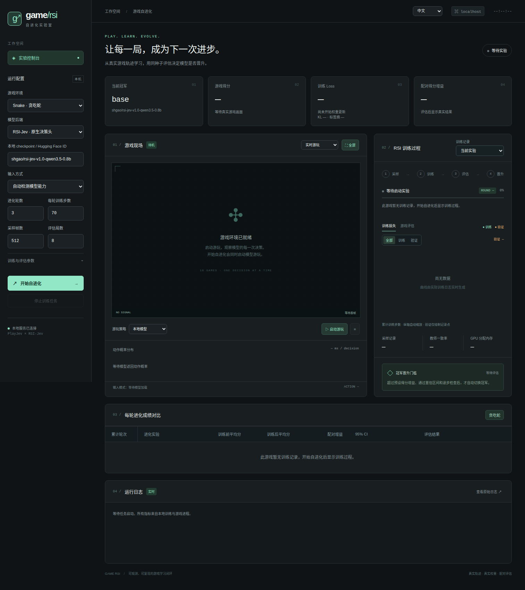
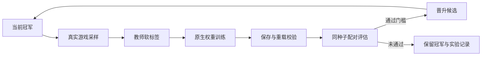

# game-rsi

[简体中文](README.md) · [English](README.en.md)

一个在真实 HTML5 游戏中运行的模型自改进实验台：**游玩 → 教师纠正 → 更新权重 → 配对评估 → 晋升冠军**。

项目组合了 [PlayJev](https://github.com/OmniJev/PlayJev) 的游戏环境、教师策略与像素模型，以及 [RSI-Jev](https://github.com/Shanghua-Gao/RSI-Jev) 的原生决策模型。FastAPI 控制台同时展示实时游戏画面、动作概率、训练 Loss / KL 和每轮评估结果。



## 能做什么

- 支持 Snake、2048、Tetris、Pacman、Racer、Invaders、Sokoban、Mario、Floppy Bird 和 Breakout 十个游戏。
- 使用真实 Chromium 游戏截图或结构化游戏状态训练，保存实际模型权重，并校验 checkpoint 重载后的预测一致性。
- 通过教师软标签进行监督学习；按游戏 seed 隔离训练、验证与游戏评估数据。
- 候选和冠军在相同评估 seed 上比较得分，默认平均收益为正即更新；也可选择检查置信区间和退步的严格模式。
- 独立进程运行训练与实时游玩，支持热切换游戏、历史实验、停止任务和服务重启后的 worker 恢复。切换游戏时会请求停止当前训练与 RSI 自进化。
- 支持中文与英文界面，语言选择保存在本机；成绩表只显示当前游戏，使用“训练前平均分 / 训练后平均分”，按时间累计显示多次实验的各轮成绩，附配对增益、置信区间和逐局明细。切换游戏会恢复该游戏的训练记录；没有记录则清空面板。
- 实时画面采用 MJPEG；Mario、Floppy Bird 支持真实中间动画帧，默认目标 30 FPS，实际帧率取决于模型与机器。

每轮及新一次实验会继承同一游戏、模型和输入契约下最近通过评估的模型权重。未晋升的候选保留成绩记录，后续训练继续使用已通过评估的模型。清空实验数据后，首次训练从所选基础模型开始。

训练目标是模仿教师的动作分布；训练种子的游戏得分用于数据筛选，独立评估种子的得分用于晋升。实验循环会调整训练配方，当前版本没有自动改写项目代码的研究代理。

## 快速开始

需要 Git、Python 3.12+、[uv](https://docs.astral.sh/uv/getting-started/installation/)，以及能够运行 Chromium 的系统。模型训练需要兼容设备的 PyTorch；默认设备为 `cuda:0`。本机验证使用 NVIDIA GB10，软件版本见 [验证记录](docs/validation.md)。

```bash
git clone https://github.com/gaohuan2020/game-rsi.git
cd game-rsi

python3 scripts/bootstrap.py --train --browser
.venv/bin/game-rsi serve --port 8092
```

打开 **http://127.0.0.1:8092**。默认每轮训练 **70 步**，已有运行保持其原始步数。选择模型、游戏和参数后，点击「开始自进化」；控制台会同时启动模型的实时游玩。选择 Teacher / Random 可以只运行教师或随机基线。

安装脚本会校验仓库内 `upstreams/` 的源码快照，恢复 `upstreams.lock.json` 中固定的上游版本，并创建项目自己的 `.venv`。恢复源码无需访问上游 Git 远端，不受上游历史改写影响；也可以用 `python3 scripts/bootstrap.py --sources-only` 单独恢复源码。安装 Python 依赖和 Chromium 仍需下载。首次加载模型需要访问 Hugging Face，也可以填写本地 checkpoint 路径。模型权重、游戏轨迹和日志均保存在本机。

启动 GPU 实验前，确认项目环境能访问 CUDA：

```bash
.venv/bin/python -c 'import torch; print(torch.__version__); print(torch.cuda.is_available()); print(torch.cuda.device_count())'
```

若 CUDA 检测失败，按 [PyTorch 官方安装说明](https://pytorch.org/get-started/locally/) 安装与设备匹配的版本；容器或受限执行环境也需要能访问 GPU 设备。

已有完整训练和服务依赖的 Python 环境，可以只读复用其安装目录：

```bash
python3 scripts/bootstrap.py \
  --reuse-python /path/to/existing-cuda-env/bin/python \
  --browser
```

此方式通过 `.pth` 引用已有包，要求原环境已经包含兼容的 `torch`、`torchvision`、`transformers` 及服务依赖。迁移到其他机器时应重新安装环境。

## 模型与训练路径

| 后端 | 模型 | 输入 | 更新范围 |
| --- | --- | --- | --- |
| PlayJev | `OmniJev/PlayJev-0.8B` | 游戏截图 | 默认最后两个语言层；可训练语言主干，视觉塔与词嵌入冻结 |
| RSI-Jev | `shgao/rsi-jev-v1.0-qwen3.5-0.8b` | 结构化游戏状态 | 默认原生 option scorer；可同时训练主干 |
| RSI-Jev 单出口 VL | 本地或 HF 的单出口 VL checkpoint | 游戏截图 | 原生 scorer，可训练文本主干，视觉塔冻结 |

RSI 的 `input_mode=auto` 根据 checkpoint 元数据选择 pixels 或 state。PlayJev 使用 pixels。RSI 多出口模型可用于游玩，当前训练流程仅支持单出口模型。

结构化状态和像素输入提供的信息不同，两条路径的游戏分数不能直接作为公平的模型能力对比。Snake 的状态输入包含从网格推导的碰撞与食物距离信息，不包含教师动作标签或累计得分。



每轮先注册配置、假设与评估 seed，然后采样和训练。默认 25% 的采样局由教师引导，其他局由模型执行，并加入 ε 随机探索。设置 `teacher_mix=0` 可以使用纯模型轨迹的教师纠正采样。

默认每轮采集 **1000 条观测**，采用 `data_strategy=trajectory`。数据策略参考 [MASS 论文的 Algorithm 3 和附录 B.2](https://arxiv.org/pdf/2610.12176) 中的候选轨迹筛选及分层采样思路，针对游戏作如下适配：

- 同一训练种子最多采集 `trajectory_candidates=3` 条候选，按真实游戏得分增量保留 `trajectory_keep=2` 条。只在同一轮、同一种子、相同动作上限内排名；预算耗尽或教师放弃的轨迹不作为优质示范。
- 保留模型动作劣于教师首选动作的纠正样本，即使所在轨迹未入选。标签仍由游戏教师提供，得分、排名和来源不进入模型输入。
- 过滤无效或均匀的教师标签，以及同一轨迹中观测和标签都相同的重复帧。旧版没有轨迹结果的记录仍可使用，但不编造排名。
- 回放缓冲区有历史时为最新一轮保留至少一半容量；训练抽样优先以各 50% 选择新旧轮次，再以 25% 选择纠正样本、75% 选择优质轨迹，之后按行为来源与回合均衡抽样。缺少某类数据时回退到可用类别。
- 验证数据使用独立的 `seed % 10 == 0` 种子，每个验证种子只采集一条轨迹并保留有效完整观测，不按得分择优，避免消耗训练候选预算；最终晋升评估使用另一保护种子空间。筛选后实际训练条数通常少于原始采集量。

`collect_steps` 是所有候选共享的总采集预算，候选数量不会倍增采样成本。每条候选仍有采样阶段的回合上限，以覆盖不同种子；它可能早于游玩界面的单局上限。设置 `data_strategy=uniform` 可运行原有均匀回放作为对照。每轮的 `data-selection.json` 保存排名、过滤数量、种子划分和实际抽样分布，`episodes.jsonl` 保存原始轨迹结果。这是数据策略适配，不是论文完整多智能体工作流的复现；游戏得分是否改善仍须由配对评估确认。

右栏得分曲线汇总当前游戏的全部历史实验，按时间和累计轮次展示训练前后得分，包括未晋升候选。切换训练记录仅改变损失与训练详情，不会隐藏历史得分。不同实验可能使用不同配置，曲线用于查看记录变化趋势。

训练采用 AdamW、梯度裁剪和余弦学习率衰减。系统记录参数变化，并在保存后重新加载 checkpoint，检查预测是否一致。非有限 loss 或梯度会中止更新。

默认 `promotion_rule=positive_gain`：在相同评估种子和步数上限下，候选平均游戏得分高于当前冠军就晋升；收益为零或负数则保留冠军。95% 置信区间和单局退步仍完整记录，但不阻止正收益模型更新。选择 `promotion_rule=strict` 可恢复同时检查相对增益阈值、置信区间和单局退步的规则。历史实验沿用当时记录的规则，不重新改写结果。失败候选和日志会保留，下一轮降低学习率。

## 运行实验

控制台实验会在历史任务中显示。也可以直接使用 CLI；CLI 运行记录位于 `artifacts/cli/`：

```bash
# RSI Snake：结构化状态，更新 scorer
.venv/bin/game-rsi evolve --config configs/rsi-snake-learning.json

# PlayJev Snake：像素输入
.venv/bin/game-rsi evolve --config configs/playjev-snake.json

# PlayJev Flappy：采集 1000 条观测
.venv/bin/game-rsi evolve --config configs/playjev-flappy-learning.json
```

| 配置 | 游戏 / 后端 | 每轮采样 | 训练步数 | Batch | 学习率 | 轮数 |
| --- | --- | ---: | ---: | ---: | ---: | ---: |
| `rsi-snake.json` | Snake / RSI | 1000 | 80 | 4 | 1e-4 | 3 |
| `rsi-snake-learning.json` | Snake / RSI | 1000 | 250 | 8 | 1e-3 | 2 |
| `playjev-snake.json` | Snake / PlayJev | 1000 | 100 | 2 | 1e-5 | 3 |
| `playjev-flappy-learning.json` | Flappy / PlayJev | 1000 | 80 | 4 | 1e-5 | 1 |

这些配置均使用 8 个评估 seed，每局最多 1000 步。学习配方是可复用的起点，具体收益需要以运行结果为准。

## 为什么 Loss 可能不下降

训练使用教师的软标签交叉熵，最低值由标签熵决定：

```text
Cross-entropy = Teacher target entropy + KL(teacher || model)
```

例如教师分布为 `[0.9, 0.1]` 时，交叉熵最低约为 **0.325083**。达到 0.3251 可以意味着模型已经接近教师分布。控制台和训练日志同时显示 `target_entropy` 与 `kl`，验证指标为 `val_target_entropy` 与 `val_kl`。

2026-10-14 在 GB10 上的检查发现：

- **Flappy：** 旧配置每局采样仅 64 步，所有采样帧中的管道均在画面外；已有验证教师一致率为 100%，KL 约为 `6.9e-6` 到 `1.5e-5`。两个教师长轨迹实验中，管道第 70 步才进入画面，第 97 步才首次得分。新的 Flappy 配置将每轮采样提高到 2400 帧。
- **Mario：** 梯度和参数更新正常。固定小批次可以拟合到接近标签熵；FP32 与 BF16 的下降幅度接近。扩大语言主干训练后，固定 64 帧训练样本 loss 从 **1.2149 降至 0.8832**，但完整 128 帧验证 loss 从 **1.2124 变为 1.2186**，表现为泛化停滞。提高学习率、扩大 batch 或固定选项顺序均未明显改善验证集。

Mario 的短轨迹 / 地图覆盖和单帧图像的信息不足仍需分别验证。详细数值和实验条件见 [Loss 诊断记录](docs/loss-diagnosis.json)。随机 batch 的 loss 会波动；不同轮次增加数据后，也需要结合标签熵、验证集与游戏得分解释曲线。

## 已验证结果

RSI Snake 的本机实验中，第一轮候选平均得分 **1.0 → 26.5**，配对增益 CI95 为 **[16.25, 35.875]**，通过晋升。第二轮候选退步到 1.0，被拒绝；首轮冠军被保留。随后在另一组未参与训练与选冠军的 8 个 seed 上，平均得分仍为 **1.0 → 26.5**。

这是指定游戏、状态输入和训练配置下的结果。PlayJev 的 checkpoint 保存 / 重载和游戏评估管线也已验证，但小预算管线检查不代表游戏能力提高。2400 帧采样的 Flappy 完整实验已完成：8 个评估 seed 上冠军与候选平均分均为 **11.625**，增益 CI95 为 **[0, 0]**，未晋升。扩充采样覆盖了管道场景，但该配方没有提高评估得分。

本机测试通过 **26 项**，浏览器检查覆盖桌面与手机布局。历史 GPU、游戏与实时画面测试的条件和边界见 [验证记录](docs/validation.md)。

## 测试与运行记录

```bash
.venv/bin/python -m pytest -q
.venv/bin/python scripts/verify_games.py

# 以下需要先启动 8092 控制台
.venv/bin/python scripts/verify_browser.py
.venv/bin/python scripts/verify_ui.py
.venv/bin/python scripts/verify_game_training.py
.venv/bin/python scripts/verify_loss_chart.py
.venv/bin/python scripts/verify_cycle.py --smoke
.venv/bin/python scripts/verify_cycle.py --config configs/playjev-release-smoke.json

# 已有 RSI Snake 晋升冠军时，用新 seed 面板只读评估
.venv/bin/python scripts/verify_champion.py
```

`verify_ui.py` 使用浏览器中的模拟 API 数据检查中英文切换、每轮与逐局成绩、手机布局和切换请求，不启动 GPU 训练。`verify_game_training.py` 检查按游戏恢复最近训练、无记录时清空面板及快速切换后的延迟请求隔离，同时覆盖多次实验的成绩累计、运行中追加轮次和刷新恢复。`verify_loss_chart.py` 检查验证曲线与记录值一致、70 步的多轮坐标、悬停、按轮断开和验证曲线单独缩放。Smoke 配置用于低预算管线验证。`verify_champion.py` 需要本机已有晋升冠军；它不会训练或更新冠军。每个运行的评估面板用于选择候选，最终效果报告应另外使用新 seed 面板。

```text
src/game_rsi/           配置、策略、采样、训练、评估、服务与网页
configs/               实验配方
scripts/               安装与验证工具
tests/                 数据隔离、晋升、API、实时画面与 Loss 指标测试
docs/                  验证记录、诊断摘要与控制台截图
upstreams/             纳入 Git 的上游运行源码、游戏与许可证快照
upstreams.lock.json    上游仓库、commit、快照包含路径与 SHA-256
artifacts/jobs/        控制台实验配置、数据、checkpoint 与评估
artifacts/cli/         CLI 运行记录
artifacts/champions/   冠军指针与前代谱系
artifacts/qa/          本机验证、诊断与截图
```

`vendor/`、`.venv/`、模型权重、轨迹和运行日志均由本机安装或运行生成，默认不提交 Git。仓库包含结果摘要，完整历史数据和已训练 checkpoint 不随源码发布。PlayJev checkpoint 使用 HF 格式，RSI checkpoint 保留原生 `meta.json`、tokenizer 和权重文件。

服务默认仅监听 `127.0.0.1`，POST 接口拒绝跨来源浏览器请求。训练 worker 使用独立锁，控制台可停止任务，并在服务重启后重新接管仍存活的 worker。

## 授权与上游

项目自身代码采用 [MIT License](LICENSE)。PlayJev、RSI-Jev、模型权重及游戏资产保留各自授权，来源与固定版本见 [THIRD_PARTY.md](THIRD_PARTY.md) 和 [upstreams.lock.json](upstreams.lock.json)。
